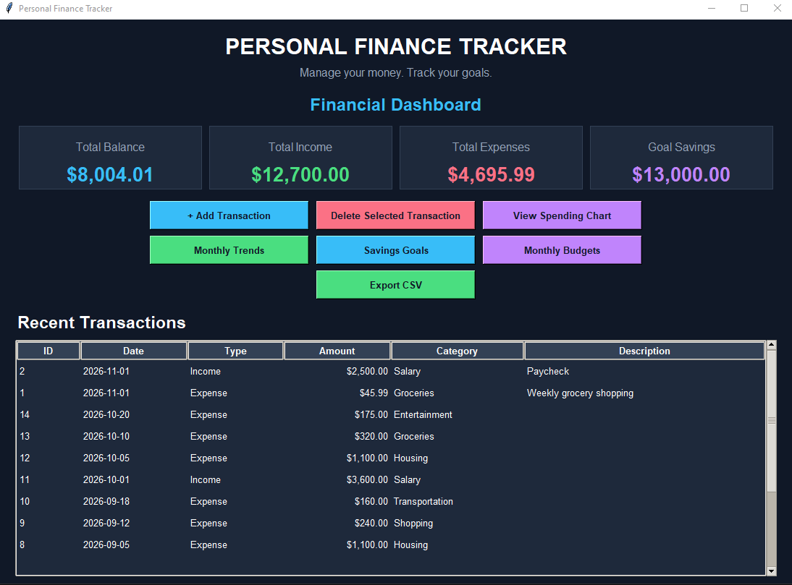
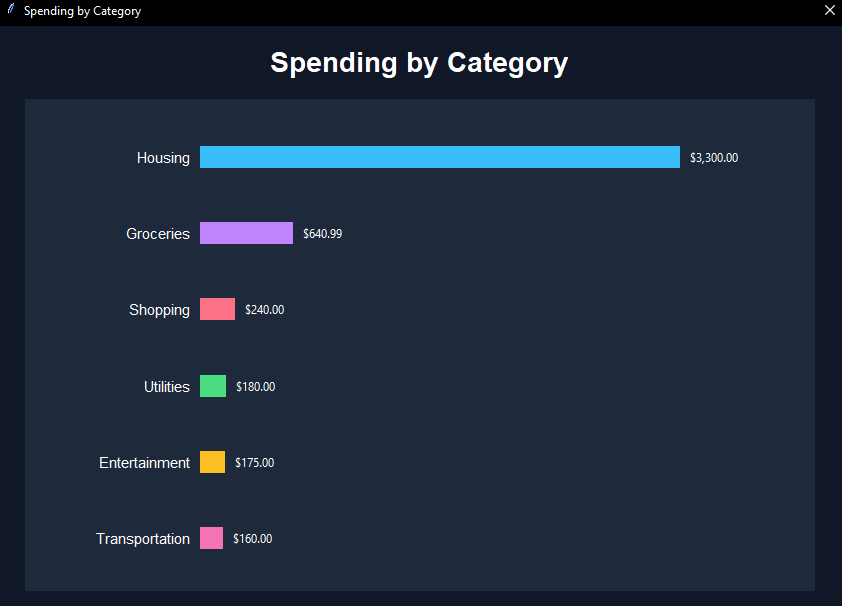
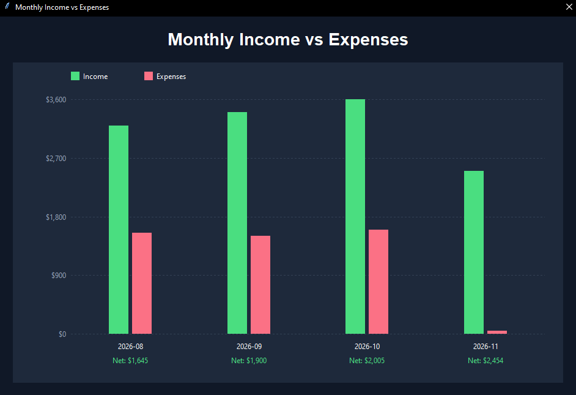
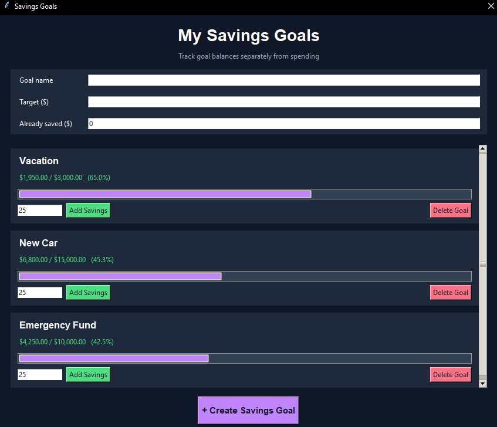
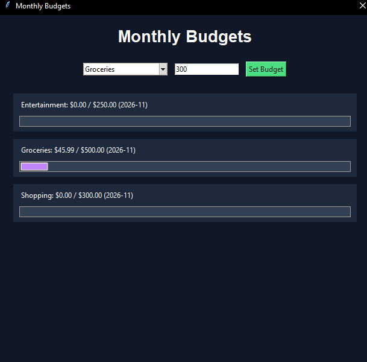

# Python_Finance_Tracker
A Python desktop application for tracking income, expenses, budgets, and savings goals using SQLite and Tkinter.

# Personal Finance Tracker

A Python desktop application designed to help users manage their finances, monitor spending, create budgets, and track savings goals.

## Project Overview

The Personal Finance Tracker is a desktop application built using Python, Tkinter, and SQLite. It allows users to record financial transactions, visualize spending patterns, manage monthly budgets, and track savings progress.

This project demonstrates skills in software development, database management, financial analysis, and data visualization.

## Features

- Financial dashboard displaying total income, expenses, balance, and savings
- Add and delete financial transactions
- SQLite database for persistent data storage
- Transaction history with dates, categories, and descriptions
- Spending analysis by category
- Monthly income vs. expenses visualization
- Savings goals with progress tracking
- Monthly spending budgets
- CSV export for financial reporting
- Dark-themed graphical user interface

## Technologies Used

- **Python** - Application development and financial calculations
- **Tkinter** - Desktop graphical user interface
- **SQLite** - Database management and persistent storage
- **SQL** - Financial data retrieval and aggregation
- **CSV** - Exporting financial transaction data
- **Tkinter Canvas** - Custom financial charts and visualizations

## Application Screenshots

### Financial Dashboard

### Spending by Category

### Monthly Income vs. Expenses

### Savings Goals

### Monthly Budgets

## How to Run

1. Install Python 3.
2. Download or clone this repository.
3. Open the project folder.
4. Run the application using:

    python finance_tracker.py

No additional third-party Python packages are required.

The application automatically creates a SQLite database when first launched.

## Project Highlights

This project demonstrates practical experience with:

- Python programming and desktop application development
- Relational database design and management
- SQL queries and financial data aggregation
- Financial data analysis and reporting
- Data visualization using custom charts
- Input validation and error handling
- Database CRUD operations
- CSV file generation and data export
- Financial budgeting and savings calculations

## Database Structure

The application uses SQLite to manage three primary database tables:

- **Transactions** - Stores income, expenses, categories, descriptions, and dates.
- **Savings Goals** - Stores savings targets and current progress.
- **Budgets** - Stores category-based monthly spending limits.

Database records are stored locally and persist between application sessions.

## Future Improvements

- Edit existing transactions
- Advanced financial reporting
- Monthly and yearly filtering
- Additional financial visualizations
- Improved responsive layouts
- More detailed budgeting features

## Author

Developed as part of a professional portfolio focused on software development, finance, and data analytics.
